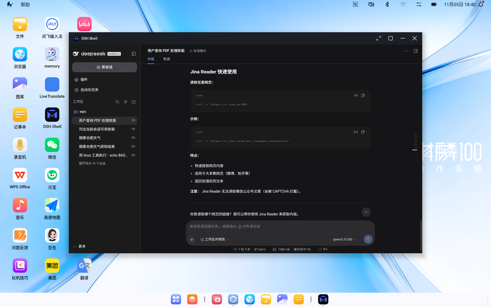
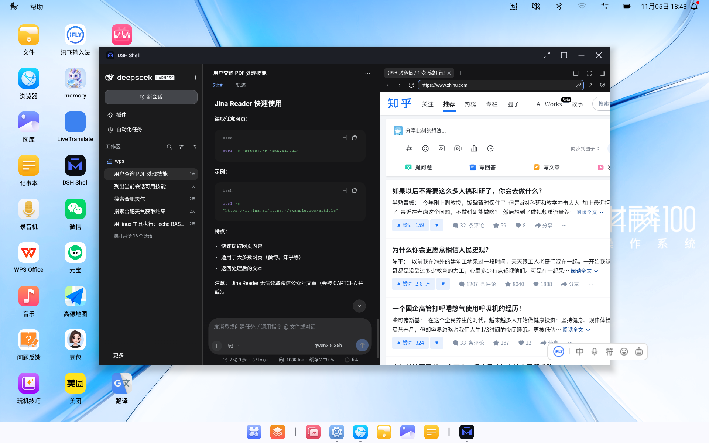

<p align="center">
  <b>简体中文</b>
</p>

<h1 align="center">dsh-android</h1>

<p align="center">
  
</p>

<p align="center">
  DeepSeek Harness 的 Android 本体。免 Root、免 Termux，一个 APK 装进完整的 Agent 运行环境——对话、终端、浏览器三面一体。
</p>

<p align="center">
  <a href="https://github.com/leemiracle/dsh-android/releases/latest"></a>
  <a href="LICENSE"></a>
  <a href="https://github.com/leemiracle/dsh-android/releases/latest"></a>
</p>

<p align="center">
  <a href="https://github.com/leemiracle/dsh-android/stargazers"></a>
  <a href="https://github.com/leemiracle/dsh-android/network/members"></a>
  <a href="https://github.com/leemiracle/dsh-android/commits"></a>
</p>

<br>

<h3 align="center">安装即用，不装 Termux 不 Root</h3>

<p align="center">Termux Node.js 24 运行时 + 完整 dsh 依赖树打进 APK（约 210MB）。首启自动解包，30-60 秒后进入完整 Web UI。</p>

<br>

<h3 align="center">对话 · 终端 · 浏览器，三面一体</h3>

<p align="center">右侧面板就是 dsh 原生的多标签 dockkit——终端跑真 bash，浏览器用原生 WebView 引擎，agent 在对话里直接驱动你看到的同一个界面。</p>

<br>

<h3 align="center">Agent 操控浏览器（browser-use 语义）</h3>

<p align="center">对话里下指令，agent 打开网页、读 DOM、点按钮、输文字、截图看页面——登录卡住时自动等你手动完成再接手。所见即所控。</p>

<p align="center">
  
</p>

<br>

<h3 align="center">完整 Linux 用户态</h3>

<p align="center">内置 Termux bootstrap rootfs（bash 5.3 / coreutils / apt / python），终端面板和 agent 工具都能用。apt install 任意软件包。</p>

<br>

<h3 align="center">技能商店与经验蒸馏</h3>

<p align="center">skillnet 搜社区技能一键安装；任务做完说「沉淀成技能」，按 SkillX 三层格式（规划/功能/原子）固化经验复用。</p>

<br>

## 可以做什么

dsh-android 是基于 [DeepSeek Harness](https://github.com/deepseek-ai/deepseek-harness)（dsh）的第三方 Android 封装，把原本运行在 Node.js 桌面/服务器端的 AI Agent 运行环境完整「搬」进手机：

- **本机运行**：APK 内嵌 Termux Node.js 24.22.1 与完整 dsh npm 依赖树，安装即用，无需 Root 或另装 Termux。
- **完整 Web UI**：dsh 官方控制台原生体验——模型对话、设置管理、会话持久化、右侧多标签面板。
- **终端面板**：内嵌 PTY（NDK 编译 node-pty）+ mksh / Linux rootfs，真命令行交互，apt 装任意工具。
- **浏览器面板**：WebView 原生引擎 + 代理隧道出网，多 Tab 切换、Cookie/LocalStorage 持久化、外链全屏窗口。
- **Agent 工具面**：`web_open / web_dom / web_click / web_type / web_screenshot / web_manual`（浏览器操控+视觉+人工接管）、`term_open / term_send`（持久终端）、`bash`（mksh）/ `linux`（rootfs 完整用户态）。
- **技能生态**：agent-reach 17 平台互联网通道、skillnet 技能商店、skill-distill 经验蒸馏。
- **工具链替换**：Android 上跑不了的沙箱 bash 换成 mksh 直跑；web_search 后端换成 Bing/引擎通道。

模型请求仍由你配置的提供方处理（默认预置局域网 vLLM `qwen3.5-35b`，也可在设置里填 DeepSeek 官方 key）。

## 架构

```
┌────────────────────────── APK (210MB) ─────────────────────────┐
│ lib/arm64-v8a/                                                   │
│   libnode_exec.so   Termux Node.js 24.22.1 (aarch64/bionic)     │
│   lib*_*.so ×10     c-ares/openssl/icu/sqlite/z/libc++/pty/flock │
│                      （改名 + patchelf 重写 SONAME/NEEDED/RUNPATH）│
│ assets/dsh-runtime.zip  dsh node_modules 瘦身树 + shim + CA      │
└──────────────────────────────────────────────────────────────────┘
            安装首启                           运行
 assets → filesDir/dsh/{web,rt}    DshService(foreground) exec
                                   nativeLibraryDir/libnode_exec.so
                                   --expose-internals dsh…bin.js web
                                   --port 0 → stdout 吐 token URL
                                   → WebView 加载 http://127.0.0.1:PORT/?token=…
```

代码全在 `app/src/main/java/com/dsh/shell/`（纯 framework API，第三方依赖仅 androidx.webkit）。

## 安装

安装要求为 Android 8.0（API 26）及以上，当前只发布 **arm64** 包（覆盖绝大多数 64 位 Android 设备）。

1. 从 [GitHub Releases](https://github.com/leemiracle/dsh-android/releases/latest) 下载 APK 并安装。
2. 首启约 30-60 秒（自动解压运行时），之后自动进入 Web UI。
3. 模型配置：默认预置局域网 vLLM（`qwen3.5-35b`）；或在 Web UI 设置→模型里填任意 OpenAI 兼容提供方。

当前构建面向已配好开发环境的测试机（模型/出网依赖局域网隧道），通用网络环境下的开箱体验在持续完善。

## 底层适配（都有实证）

| 适配 | 原因 |
|---|---|
| Termux node 24 而非 nodejs-mobile | nodejs-mobile 止步 Node 18；dsh 实测 18/20 均崩，22+ 才活 |
| node 进 jniLibs + `useLegacyPackaging` | targetSdk≥29 只允许 exec nativeLibraryDir；filesDir W^X 禁 exec |
| 10 个 .so 改名 + patchelf 全链重写 | AGP 静默丢弃 SONAME≠文件名或无 SONAME 的 jniLib |
| `--expose-internals` + shim | cordis 启动链硬依赖 glibc 预编译 .node；bionic 加载不了，shim 用 internal require 顶替 |
| NDK r29 编译 flock / node-pty | 会话持久化 lease 与终端 PTY 的原生绑定，上游只发 linux prebuild |
| session 落盘 link→rename | Android SELinux 对 app_data_file 禁 hardlink（EACCES），patch 改 rename 保住原子性 |
| **targetSdk 28**（Termux 生存之道） | 恢复 app 数据目录可执行 → Termux bootstrap rootfs（bash/apt/python）直接装进 `files/dsh/linux` |
| WebView 分流代理（ProxyController） | 本地 dsh UI 直连；外网页面经宿主 clash 隧道出网 |
| auth cookie 名按 host 哈希 | 上游按 host:port 哈希，每 boot 换端口→cookie 累积→HTTP 431 网页打不开 |

### 出网与模型隧道

设备无直连外网且本地网关 TLS 拦截。出网统一经宿主机（开发机执行），**这是浏览器面板外网页、agent 联网工具和 apt 装包的硬依赖**——隧道断了外网页面全部「网页无法打开」：

```sh
adb reverse tcp:11433 tcp:11433   # vLLM 模型（kylin100.sh tunnel 已含）
adb reverse tcp:8333  tcp:7890    # node 出网（HTTP(S)_PROXY 已注入）
adb reverse tcp:7890  tcp:7890    # WebView 外网页 ← 断了=网页打不开
adb reverse tcp:8391  tcp:8391    # apt/pkg（配合 tools/termux-proxy.py）
```

## 从源码构建

以下流程面向 **Linux x86_64**（需 JDK 21、Android SDK/NDK r29、Gradle 8.11+、patchelf）：

```bash
git clone https://github.com/leemiracle/dsh-android.git
cd dsh-android

# 1) 重建运行时（termux deb + npm + prune + shim + patchelf + NDK 编译，幂等可复现）
bash tools/build-runtime.sh /tmp/dsh-build

# 2) 出 APK
./gradlew assembleDebug
adb install -r app/build/outputs/apk/debug/app-debug.apk
```

升级 dsh 版本：改 `tools/build-runtime.sh` 里 `DSH_NPM_VERSION` 重跑即可（上游仓库零改动，全部适配在 overlay patch 里）。

## 目录

| 路径 | 内容 |
| --- | --- |
| `app/src/main/java/com/dsh/shell/` | 壳层 Kotlin：MainActivity / DshService / DshRuntime / BrowserOverlay / LinuxSandbox / DshBrowserActivity |
| `tools/build-runtime.sh` | 运行时构建主管（deb/npm/prune/shim/patchelf/NDK/技能挂载） |
| `tools/kylin-tools/` | 工具替换 bundle（bash/linux/web_*/term_* 工具 + preset 重述 patch） |
| `tools/skills/` | 自研 dsh 技能（skillnet 技能商店 / skill-distill 经验蒸馏） |
| `tools/termux-proxy.py` | apt 隧道 HTTPS 终结代理（GPG 端到端校验保留） |
| `app/src/main/jniLibs/arm64-v8a/` | NDK 编译产物（libflocknode.so / libptyexec.so）+ Termux 改名库 |

## 常见问题

<details>
<summary><b>和 DeepSeek 官方是什么关系？</b></summary>
<br>

没有关系。dsh-android 是社区开发的非官方封装，基于开源的 [DeepSeek Harness](https://github.com/deepseek-ai/deepseek-harness) 构建。手机上运行的是 dsh 本身；模型请求发给你配置的模型提供方。

</details>

<details>
<summary><b>需要 Root 或 Termux 吗？</b></summary>
<br>

都不需要。Node 运行时、dsh 依赖树和 Linux rootfs 全部打进 APK，安装即用。可选的 bootstrap rootfs（bash/apt）也在 app 数据目录内自动安装。

</details>

<details>
<summary><b>浏览器面板和系统浏览器有什么区别？</b></summary>
<br>

面板内容区是壳内原生 WebView 引擎：cookie/localStorage 持久（登录一次全 tab 共享）、无 iframe 反嵌限制、agent 可直接操控你看到的页面（含截图视觉）。外链点击会开壳内全屏浏览器窗口（返回键回对话）。

</details>

<details>
<summary><b>浏览器面板/网页打不开（「网页无法打开」）？</b></summary>
<br>

按顺序排查两件事：

1. **出网隧道**。设备无直连外网，所有外部网页经宿主机 clash 代理隧道出网。若宿主机未执行 `adb reverse tcp:7890 tcp:7890`（或开发机已断开），所有外网页面都会显示「网页无法打开」。本机 UI（对话/设置）不受影响。
2. **Cookie 溢出（历史版本坑，已修复）**。早期版本 auth cookie 名含端口（每次启动换端口→新 cookie），累积后请求头超限，服务端返回 431。当前版本已按 host 固定 cookie 名并自动清理旧 cookie；若使用旧版 APK 升级后仍复现，重新安装一次即可。

另：个别站点（百度搜索结果页等）会把顶层导航劫走——按返回键会自动回到对话界面。

</details>

<details>
<summary><b>agent-reach / apt 装包失败？</b></summary>
<br>

两者都依赖宿主机侧的配套通道：apt 需要 `adb reverse tcp:8391 tcp:8391` + 宿主机运行 `tools/termux-proxy.py`；agent-reach 的网页通道需要 8333/7890 隧道。已装好的工具（git/openssh/jq 等）不受影响，只有装新包时需要。

</details>

<details>
<summary><b>切到后台会被杀吗？</b></summary>
<br>

前台服务 + 通知栏常驻已覆盖大多数场景。部分 ROM 的后台清扫仍可能杀进程（已做 onTaskRemoved 自重启缓解）；建议在系统设置里给本 app 开后台运行白名单。

</details>

<details>
<summary><b>开源吗？</b></summary>
<br>

开源，代码就在这个仓库，以 [MIT](LICENSE) 发布。上游 [DeepSeek Harness](https://github.com/deepseek-ai/deepseek-harness) 与 [Termux](https://termux.dev) 保留各自许可证。

</details>

## 参与贡献

问题反馈和改进建议请提交到 [Issues](https://github.com/leemiracle/dsh-android/issues)。

## 风险提示

AI 并非万无一失：回答、代码和操作可能出错，也可能被网页或文件中的恶意指令误导。终端与 shell 工具会产生真实影响（文件修改、软件安装）；请核验重要结果，不要让 agent 无人值守处理不可逆任务。本软件按「现状」提供，详见 [LICENSE](LICENSE)。

## 许可证与致谢

本项目采用 [MIT](LICENSE)。

- [DeepSeek Harness](https://github.com/deepseek-ai/deepseek-harness)：本仓封装和运行的引擎。
- [Termux](https://termux.dev)：Node.js 运行时与 bootstrap rootfs 的来源。
- [agent-reach](https://github.com/Panniantong/agent-reach)：17 平台互联网通道技能。
- [SkillNet](https://github.com/zjunlp/SkillNet) / [SkillX](https://github.com/zjunlp/SkillX)：技能商店与经验蒸馏方法。

<br>

<p align="center"><sub>dsh-android 是社区开发的非官方项目，与 DeepSeek 没有关联，也不代表 DeepSeek。DeepSeek 名称与标识归其所有者所有。</sub></p>
